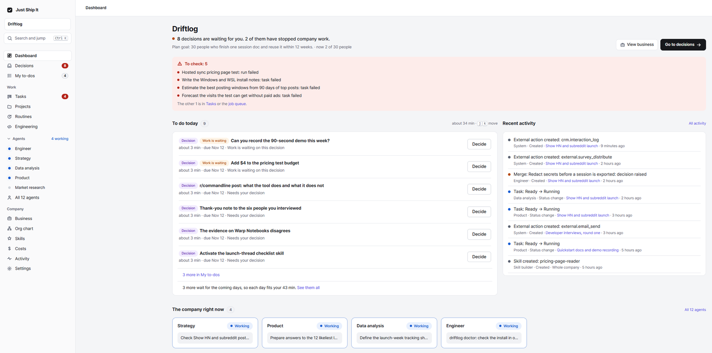
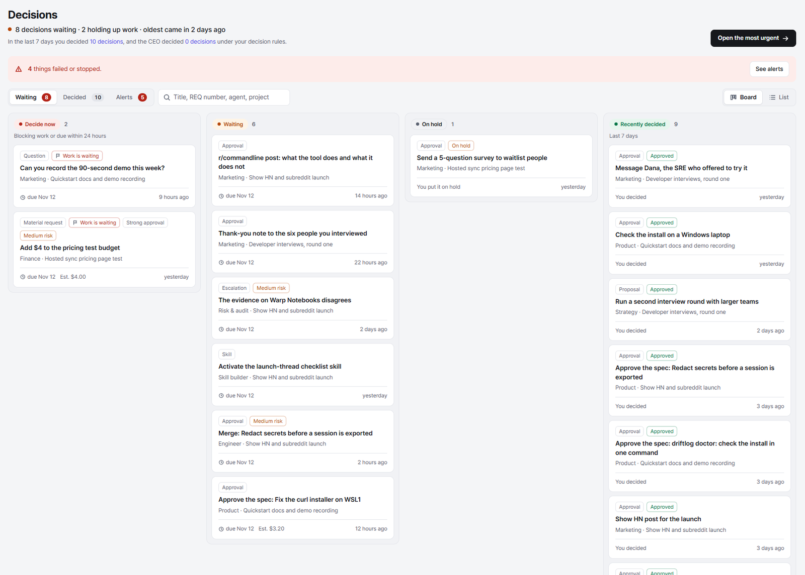
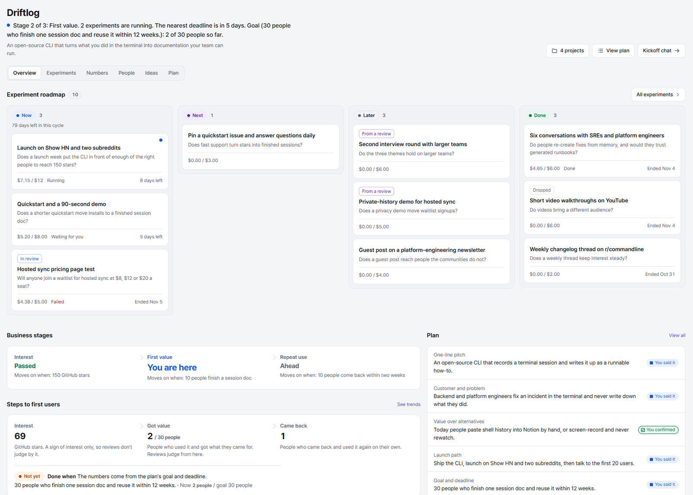

<p align="center">
  <a href="README.md">English</a> · <b>한국어</b>
</p>

<p align="center">
  <picture>
    <source media="(prefers-color-scheme: dark)" srcset="docs/assets/logo-on-dark.png">
    
  </picture>
</p>

<h3 align="center">아이디어에서 첫 이용자 100명까지, 사업 초기를 AI 회사와 함께 운영합니다</h3>

<p align="center">
  CEO 에이전트와 팀이 내 PC에서, 내 Claude 구독으로 계획하고 조사하고 만들고 출시를 준비합니다.
  단계마다 오너가 승인합니다. 사람은 오너가 직접 만납니다.
</p>

<p align="center">
  <a href="pyproject.toml"></a>
  
  
  
</p>

<p align="center">
  <a href="#시작하기">시작하기</a> ·
  <a href="#사업이-움직이는-방식">동작 방식</a> ·
  <a href="#콘솔">콘솔</a> ·
  <a href="docs/OPERATIONS.ko.md">운영 안내</a> ·
  <a href="PRODUCT.md">제품</a> ·
  <a href="docs/ARCHITECTURE.md">아키텍처</a>
</p>

<p align="center">
  
</p>
<p align="center"><sub>예시 데이터로 채운 데모 사업 Driftlog의 대시보드입니다. 화면은 영어로 찍었습니다.</sub></p>

**준비물**은 Docker, uv, Node.js와 npm, git, 그리고 Claude 구독으로 로그인한 Claude Code(`claude`)입니다. 받아서
한 번 설정하고 켭니다.

```sh
git clone https://github.com/kiduki77/just-ship-it.git
cd just-ship-it
docker compose up -d
uv sync
cd web && npm ci && npm run build && cd ..
uv run ship init
uv run ship sandbox build
uv run ship supervise --concurrency 4 --port 8000
```

`supervise`는 워커와 콘솔을 함께 켜고 로그인 주소를 출력합니다. 그 주소를 10분 안에 열면 http://127.0.0.1:8000 에서
콘솔이 열립니다. **새 사업 시작**을 누르고 CEO에게 아이디어를 이야기하세요. Ctrl+C로 워커와 콘솔을 함께 멈춥니다.

샌드박스 빌드는 처음 한 번이고 몇 분 걸립니다. 그다음부터는 `docker compose up -d`와 `supervise`로 회사를 켭니다. 각
단계의 설명은 [시작하기](#시작하기)에 있습니다.

## 왜 Just Ship It인가

아이디어는 대개 "어떻게 시작할지 모르겠고, 귀찮다"에서 멈춥니다. Just Ship It은 계획, 조사, 개발, 출시 준비를 맡고,
결정과 사람 만나는 일을 오너에게 남깁니다. 100명은 보장이 아니라 목표입니다.

**승인하면 그다음은 알아서 돌아갑니다.** 오너와 CEO는 짧은 시작 대화로 계획을 함께 정합니다. 계획의 줄마다 오너가 말한
것인지, 오너가 확인한 것인지, CEO가 짐작한 것인지 표시됩니다. CEO는 단계로 이뤄진 사이클을 제안하고, 오너가 시작한
단계만 돌아갑니다. 사용량을 쓰거나 오너의 할 일을 만드는 일은 오너의 승인 없이 돌지 않습니다.

**되돌릴 수 없는 일은 오너가 정합니다.** 게시, 지출, 외부 발송, 방향 변경, 코드 머지는 추천안을 맨 앞에 둔 결정
카드로 오너에게 옵니다. 계획 범위 안의 안전한 몇 가지는 CEO가 정하고 보고만 합니다. 초기 실전 실행에서 오너에게 온
요청 67건 중 57%가 불필요했습니다. 그래서 지금은 안전한 결정을 CEO가 맡습니다.

**사람은 오너가 만나고, 회사는 준비합니다.** 회사는 커뮤니티에 글을 올리지 않습니다. 어디에, 무엇을, 언제 올릴지
정하고 글을 쓴 뒤 내 할 일로 넘깁니다. 오너가 직접 올리고 결과를 기록합니다. 보고서는 내 할 일에서 끝났다고 표시된
것만 했다고 씁니다. 사람을 직접 만나는 일도 오너의 몫입니다.

**모든 주장에 확신도가 붙습니다.** 주장마다 검증됨, 출처 있음, 가정 중 하나가 붙습니다. 서버는 모든 출처 주소에
직접 접속해 인용문이 실제로 있는지 확인합니다. 작성자와 다른 역할의 검토자가 지지하고 서버 확인도 통과해야 검증됨이
됩니다. 초기에는 대부분 검증할 수 없으므로 검증을 관문으로 쓰지 않습니다.

**만들 것이 있으면 개발팀이 만듭니다.** 사업에 소프트웨어가 필요하면 회사가 명세를 쓰고 오너가 승인합니다. 개발팀
(pstack 플러그인을 쓰는 Claude Code)은 호출마다 새 컨테이너에서 만들고, 컨테이너는 그 개발 작업의 clone만 봅니다.
작성자와 다른 역할의 검토자가 코드를 보고, 머지는 매번 오너가 승인합니다. 배포는 회사가 하지 않습니다.

**내 PC, 내 구독, 내가 정한 한도.** 모든 것이 내 PC에서 돌고 내 구독으로 `claude -p`를 부릅니다. API 키는 없습니다.
사용량은 오너가 정한 상한을 따릅니다. 상한이나 구독 한도에 닿으면 실패하지 않고 기다렸다가 멈춘 곳부터 이어 갑니다.

**오너 모르게 나가는 것은 없습니다.** 외부 커넥터는 처음에 보관함 모드입니다. 회사가 보내려는 것은 오너가 설정에서
발송을 켤 때까지 보관함에서 기다립니다.

## 사업이 움직이는 방식

사업은 사이클로 움직입니다. 사이클은 계획을 향해 일하는 한 바퀴이고, CEO가 제안한 단계들로 이뤄집니다.

1. **사업을 시작합니다.** 시작 대화는 최대 20턴입니다. CEO가 아이디어를 묻고, 오너는 기획서나 발표 자료(PDF, DOCX,
   PPTX, 마크다운, 텍스트)를 붙일 수 있습니다.
2. **계획을 승인합니다.** 무슨 사업인지, 누가 쓸지, 어떻게 되면 성공인지, 하지 않을 일은 무엇인지 적혀 있습니다. 회사는
   이 안에서 일합니다.
3. **CEO의 제안을 읽습니다.** CEO가 이번 사이클을 몇 문장으로 설명하고 단계 4~9개를 올립니다. 기본 틀은 정의 → 기획 →
   설계 → 검증 → 개발 → 홍보 → 반응 확인 → 리뷰 반영 → 다시 홍보이고, CEO가 사업에 맞게 합치거나 빼거나 순서를
   바꿉니다. 단계 카드에는 회사가 하는 일, 오너가 할 일, 걸릴 시간과 사용량(짐작으로 표시), 결정이 필요한 때가 있습니다.
4. **단계를 시작하거나 바꿀 점을 말합니다.** 바꿀 점을 적으면 CEO가 고친 안을 다시 올리고 바뀐 곳을 표시합니다.
   단계 이름이 붙은 **시작** 버튼을 누르면 그 단계만 돌아갑니다. 대시보드에 그 단계의 업무와 각 업무를 맡은 에이전트가 보입니다.
5. **단계가 끝날 때마다 회사는 멈춥니다.** 무엇을 했는지, 비용이 얼마였는지, 어떤 근거가 나왔는지 확신도와 함께
   요약합니다. 오너는 다음 단계를 시작하거나, 바꿀 점을 말하거나, 여기서 멈춥니다. 이 멈춤은 결정이라서 대시보드
   맨 위에 옵니다.
6. **사이클은 회고로 끝납니다.** CEO가 사이클을 돌아보고 다음 사이클을 제안합니다.

단계 안에서는 에이전트들이 업무를 병렬로 합니다. 업무마다 작성자와 다른 역할의 검토자가 확인합니다. 에이전트끼리
의견이 갈리면 회의를 열고 CEO가 정합니다. 오너만 할 수 있는 일(게시, 결제, 가입, 사람 만나기)은 내 할 일이 됩니다.

## 콘솔

콘솔은 오너와 회사가 함께 일하는 곳입니다. 하루에 몇 번 들러 확인합니다. 오너를 기다리는 것은 그 화면의 맨 위에 있고,
회사가 일하는 동안 화면이 실시간으로 바뀝니다.

| 결정 | 사업 |
| --- | --- |
|  |  |

화면은 대시보드, 시작 대화, 결정, 내 할 일, 업무, 프로젝트, 정기 업무, 개발, 에이전트, 사업, 꾸린 팀, 스킬, 비용,
활동, 설정입니다. 밝은 테마와 어두운 테마가 있고, 영어나 한국어로 볼 수 있습니다(**설정** > **언어**). 여기 있는
화면은 모두 예시 데이터로 채운 데모 사업 Driftlog이고, 영어로 찍었습니다.

## 통제 원칙

아래 규칙은 프롬프트가 아니라 코드에 있습니다.

| 규칙 | 코드가 지키는 방식 |
| --- | --- |
| 에이전트는 부수효과 도구가 없다 | 비즈니스 에이전트는 `WebSearch`와 `WebFetch`만 씁니다. 외부 행동은 Agent Request로만 합니다. |
| 정책은 코드가 강제한다 | `config/tool_policy.yaml`과 `services/policy.py`. 요청은 정책을 더 엄격하게만 만들 수 있습니다. |
| 승인에는 범위와 만료가 있다 | 승인마다 금액, 횟수, 만료가 있고, 실행 직전에 `consume_grant`가 다시 확인합니다. |
| 사실과 추론을 나눈다 | 에이전트는 `verified_fact`를 쓸 수 없습니다. 서버가 주소를 직접 확인하고, 작성자와 다른 역할의 검토가 지지할 때만 올립니다. |
| 재무 수치는 코드가 계산한다 | CFO 에이전트는 가정만 내고, `services/finance.py`가 계산합니다. |
| 무한 반복은 없다 | 재작업, 계획 라운드, 회의 횟수, 업무 수, 동시성 모두 `config/company.yaml`에 상한이 있습니다. |
| 사용량은 쓰기 전에 예약한다 | 호출 전에 미리 예약하고 실제 사용량으로 정산합니다. 월, 프로젝트, 업무 단위로 행을 잠급니다. |
| 개발팀은 혼자 내보내지 못한다 | Claude Code deny 규칙이 `git push`, remote, merge, `gh`, ship 스킬을 막습니다. push와 PR은 워커 코드가 승인을 다시 확인한 뒤 합니다. 머지는 매번 강한 승인이 필요합니다. |
| 승인한 명세는 고정된다 | 개발은 승인된 명세의 커밋에서 하므로 승인 뒤의 수정이 섞이지 않습니다. |
| 에이전트는 자기 규칙을 고치지 못한다 | 에이전트는 `config/`와 `prompts/`에 접근할 수 없습니다. |

## 시작하기

### 준비물

- Docker. Windows에서는 Docker Desktop.
- uv. Python 3.13 이상이 필요하고, uv가 설치할 수 있습니다.
- 콘솔을 빌드할 Node.js와 npm.
- Claude 구독으로 로그인한 Claude Code(`claude`).
- git. 2.45.1 이상을 권장합니다. 워커가 개발 작업에 받는 버전은 [운영 안내](docs/OPERATIONS.ko.md#git-버전)에 있습니다.
- gh(선택).

Just Ship It은 Windows에서 개발하고 운영합니다. `supervise --install`은 Windows 전용입니다.

### 한 번만 설정하기

1. Postgres(55432 포트)와 샌드박스 출구 프록시를 켭니다. 둘 다 127.0.0.1에서만 열립니다.

   ```sh
   docker compose up -d
   ```

2. Python 의존성을 설치합니다.

   ```sh
   uv sync
   ```

3. 콘솔을 빌드합니다. 빌드 결과는 저장소에 없어서 처음 받은 PC에서도 필요합니다. 콘솔 변경을 받은 뒤에도 다시
   실행합니다.

   ```sh
   cd web && npm ci && npm run build && cd ..
   ```

4. 회사를 초기화합니다. `init`은 Postgres의 무작위 비밀번호를 `.env`에 쓰고, 그 비밀번호로 서비스를 다시 만들고,
   마이그레이션을 실행하고, `registry/`, `products/`, 체크포인트 테이블을 만듭니다.

   ```sh
   uv run ship init
   ```

5. 엔지니어와 데이터 분석 컨테이너 이미지를 빌드합니다. 처음 한 번이고 몇 분 걸립니다.

   ```sh
   uv run ship sandbox build
   uv run ship sandbox check
   ```

   `sandbox check`는 Docker, 이미지, Claude 로그인, 엔지니어 샌드박스가 준비됐는지 보여 줍니다.

### 회사 켜기

```sh
uv run ship supervise --concurrency 4 --port 8000
```

`supervise`는 워커(동시 작업 4개)와 콘솔(8000 포트)을 켜고, 어느 쪽이든 꺼지면 다시 켭니다. Ctrl+C로 둘 다 멈춥니다.
워커는 실행 중인 호출을 끝내고 작업을 대기열로 돌려놓으므로, 다음에 켜면 마지막 체크포인트부터 이어 갑니다.

콘솔은 `http://127.0.0.1:8000/?login=…` 같은 로그인 주소를 출력합니다. 10분 안에 한 번만 쓸 수 있고, 열면 브라우저가
30일짜리 로그인 쿠키를 받습니다. 콘솔이 켜져 있는 동안 새 주소가 필요하면 다음 명령을 씁니다.

```sh
uv run ship api --login
```

### 첫 사업 시작하기

콘솔의 기본 언어는 영어입니다. 콘솔과 회사가 쓰는 글을 한국어로 바꾸려면 **Settings** > **Language**를 엽니다.
그다음 **새 사업 시작**을 누릅니다.

### 지켜보지 않는 PC에서 계속 돌리기

```sh
uv run ship supervise --install
```

로그인할 때마다 `supervise`를 켜는 Windows 로그온 작업 "Just Ship It"을 등록합니다. Docker Desktop에서 **Start Docker
Desktop when you sign in**도 켜 두세요. 이 작업은 부팅이 아니라 로그인할 때 시작합니다. Claude 로그인이 사용자 계정에
있기 때문입니다. 로그, 상태 확인, 백업과 복원, API 토큰, 다른 기기에서 콘솔 쓰기는 [운영 안내](docs/OPERATIONS.ko.md)에
있습니다.

## 안에서 쓰는 것

- **오케스트레이션.** Postgres 체크포인트를 쓰는 LangGraph. 오너 승인은 `interrupt()`로 그래프를 멈춥니다.
- **에이전트.** CEO부터 개발 리뷰어까지 열두 역할이 `config/agents.yaml`에 있습니다. 비즈니스 에이전트의 호출은
  자기 시스템 프롬프트, 사용자 MCP 서버와 스킬 없이, 허용 목록의 도구만 쓰는 `claude -p`입니다.
- **데이터.** 업무, 근거, 결정은 PostgreSQL과 pgvector에 있습니다. 콘솔 실시간 이벤트(NOTIFY)와 공급자 동시 실행
  슬롯(advisory lock)도 PostgreSQL이 맡습니다.
- **문서.** 계획, 업무 산출물, 회의록, 보고서, 명세, 스킬은 별도 git 저장소인 `registry/`에 커밋됩니다.
- **개발팀.** 호출마다 새 컨테이너에서 도는 pstack 플러그인 Claude Code. 작성자와 다른 역할의 검토자가 코드를 보고,
  테스트는 워커가 Docker 샌드박스에서 돌립니다.
- **제품.** 회사가 만드는 제품은 각각 `products/<repo>/` 아래의 독립 git 저장소입니다.
- **콘솔.** React 19와 Vite로 만들고 FastAPI가 서빙합니다. SSE로 실시간 갱신합니다.
- **회사 기억.** 로컬 임베딩(`google/embeddinggemma-300m`)을 pgvector에 둬서, 한 프로젝트가 찾은 것을 다른 프로젝트가
  다시 조사하지 않습니다.
- **그 밖에.** 지난 업무를 다시 돌려 새 스킬을 시험하는 Skill Factory, 정기 업무 스케줄러, 커넥터용 Tool Gateway.

## 문서

- [제품](PRODUCT.md)(영어): 누구를 위한 제품인지, 원칙, 콘솔이 쓰는 용어.
- [운영 안내](docs/OPERATIONS.ko.md): 지켜보지 않는 PC에서 돌리기, 로그, 백업, 콘솔 로그인, 엔지니어 샌드박스, 데이터
  분석, 명령 모음.
- [개발 안내](docs/DEVELOPMENT.ko.md): 이 저장소를 고치는 법, Windows에서 테스트 돌리기, 디렉터리 구조.
- [언어](docs/I18N.md)(영어): 영어와 한국어가 동작하는 방식과 용어집.
- [아키텍처](docs/ARCHITECTURE.md): 설계 결정과 첫 실전 실행에서 바뀐 것.
- [로드맵](docs/ROADMAP.md), [운영 개선 할 일 목록](docs/BACKLOG.md),
  [아이디어에서 첫 이용자 100명까지](docs/ux/08-first-100.md): 만들어진 것과 계획 중인 것.

## 현재 상태

Just Ship It은 버전 0.1.0이고 만든 사람의 PC에서 돌고 있습니다. 다른 사용자, 고객, 후기는 아직 없습니다. 두 가지는
계획만 있고 아직 없습니다. Slack에서 바로 승인하기, Gmail 연결(메일 읽기와 승인 후 발송)입니다.

## 라이선스

[MIT](LICENSE)입니다. 다른 프로젝트에서 온 것은 [THIRD_PARTY_NOTICES.md](THIRD_PARTY_NOTICES.md)에 있습니다. gstack(MIT 라이선스)에서
가져와 고친 프롬프트 규칙과 impeccable 디자인 스킬(Apache License 2.0)입니다.
