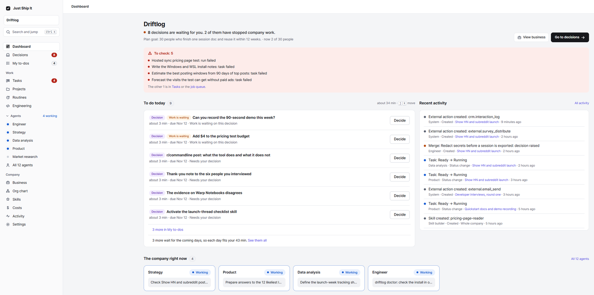
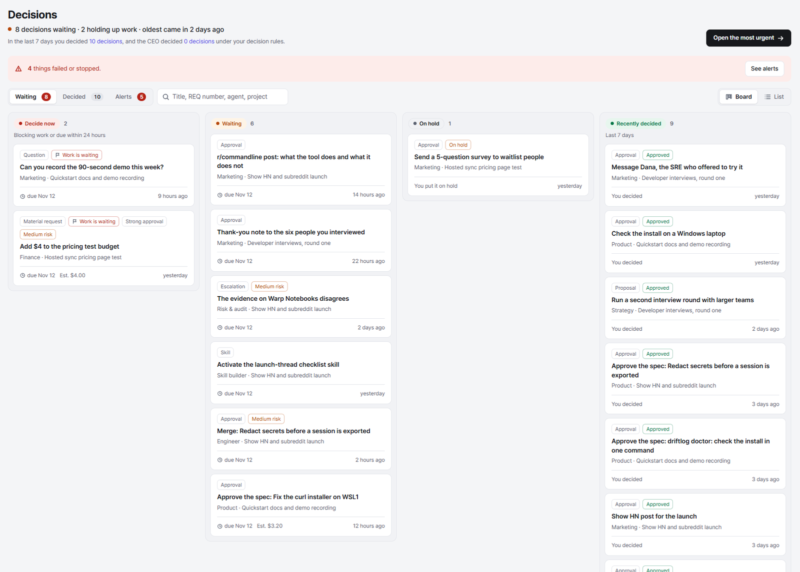
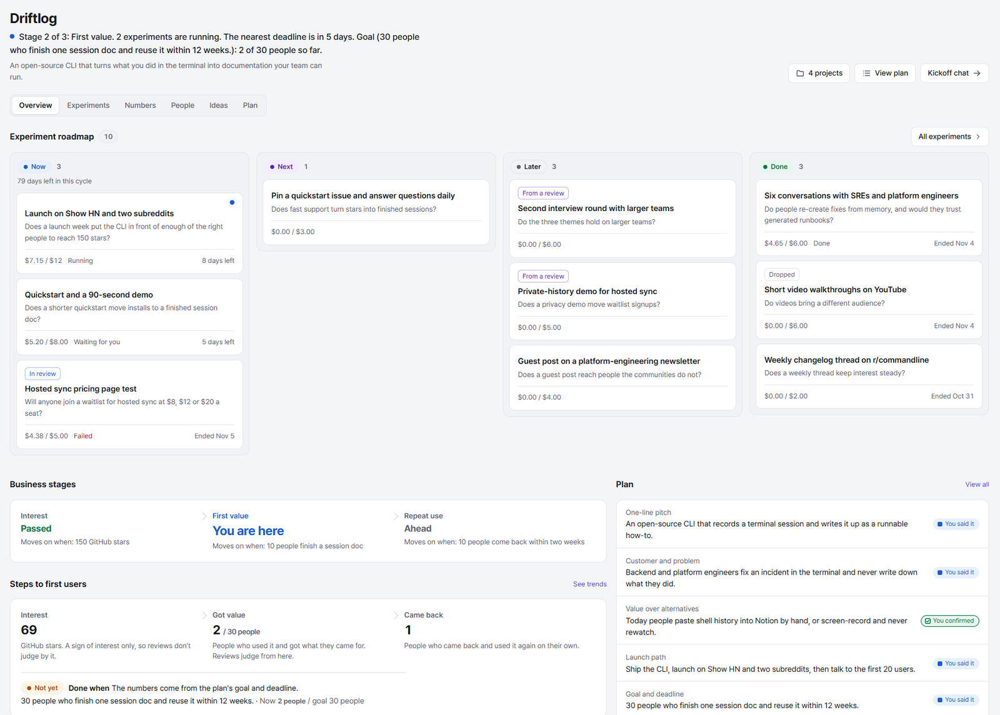

<p align="center">
  <b>English</b> · <a href="README.ko.md">한국어</a>
</p>

<p align="center">
  <picture>
    <source media="(prefers-color-scheme: dark)" srcset="docs/assets/logo-on-dark.png">
    
  </picture>
</p>

<h3 align="center">Run the early days of your business with an AI company, from an idea to its first 100 users</h3>

<p align="center">
  A Project Manager agent plans the work, and a team put together for each job researches, builds, and
  prepares your launch on your own PC, on your own Claude subscription. You approve each stage. You meet the users.
</p>

<p align="center">
  <a href="pyproject.toml"></a>
  
  
  
</p>

<p align="center">
  <a href="#get-started">Get started</a> ·
  <a href="#how-a-business-moves">How it works</a> ·
  <a href="#the-console">The console</a> ·
  <a href="docs/OPERATIONS.md">Operations</a> ·
  <a href="PRODUCT.md">Product</a> ·
  <a href="docs/ARCHITECTURE.md">Architecture</a>
</p>

<p align="center">
  
</p>
<p align="center"><sub>The dashboard of Driftlog, a demo business with sample data.</sub></p>

**You need** Docker, uv, Node.js with npm, git, and Claude Code (`claude`) signed in with your Claude
subscription. Then clone, set up once, and start:

```sh
git clone https://github.com/kiduki77/just-ship-it.git
cd just-ship-it
docker compose up -d
uv sync
cd web && npm ci && npm run build && cd ..
uv run ship init
uv run ship sandbox build
uv run ship supervise --concurrency 4 --port 8000
```

`supervise` runs the worker and the console together and prints a login address. Open it within 10 minutes, and the
console opens at http://127.0.0.1:8000. Click **Start a business** and tell the Project Manager about your idea.
Ctrl+C stops the worker and the console together.

The sandbox build runs once and takes several minutes. After that, `docker compose up -d` and `supervise` start the
company. [Get started](#get-started) explains each step.

## Why Just Ship It

Most ideas stop at "I don't know how to launch this, and it is tedious." Just Ship It takes on the planning, the
research, the building, and the launch preparation, and leaves you the decisions and the people. The 100 users are a
target, not a promise.

**You approve, then it runs on its own.** You and the Project Manager agree on a plan in a short kickoff chat. Each
line of the plan shows whether you said it, you confirmed it, or the Project Manager guessed it. The Project Manager
then proposes a cycle of stages, and only the stage you start runs. Nothing that spends model usage or adds a to-do
for you runs without your approval.

**You decide what can't be undone.** Publishing, spending, sending anything outside, changing direction, and merging
code reach you as decision cards, with the recommendation first. The Project Manager decides a short list of safe
calls inside the plan and only reports them. In an early real run, 57% of 67 requests to the owner were noise. That is
why the Project Manager now takes the safe calls.

**You meet the users. The company prepares.** The company never posts to communities. It works out where, what, and
when to post, drafts the words, and gives you a to-do. You post by hand and record the result. Reports claim only what
your to-dos say is done. Talking to people is yours too.

**Every claim shows how sure it is.** Each claim is labelled verified, sourced, or assumed. The server opens every
source URL and checks that quotes are really there. A claim becomes verified only when a reviewer in a different role
supports it and the server's check passes. Early on, most claims can't be verified, so
verification does not block the work.

**An engineering team for what needs building.** When the business needs software, the company writes a spec and you
approve it. The engineering team, Claude Code with the pstack plugin, builds it in a fresh container for every call,
and the container sees only that job's clone. A reviewer in a different role checks the code, and you approve each
merge. The company does not deploy.

**Your PC, your subscription, your limits.** Everything runs locally and calls `claude -p` on your subscription. There
are no API keys. Usage follows caps you set. When a cap or the subscription limit is hit, work waits and resumes where
it stopped.

**Nothing leaves without you.** External connectors start in the outbox. Whatever the company would send waits there
until you turn sending on in Settings.

## How a business moves

A business moves in cycles. A cycle is one round of work toward the plan, made of stages the Project Manager proposes.

1. **Start a business.** The kickoff chat takes at most 20 turns. The Project Manager asks about your idea, and you
   can attach planning documents (PDF, DOCX, PPTX, Markdown, or text).
2. **Approve the plan.** It says what the business is, who it is for, what success looks like, and what is off limits.
   The company works inside it.
3. **Read the Project Manager's proposal.** The Project Manager explains the cycle in a few sentences and lists 4 to 9
   stages. A cycle often runs define, plan, design, validate, build, promote, check reactions, apply reviews, and
   promote again. The Project Manager merges, drops, or reorders stages to fit your business. Each stage card says
   what the company does, what you do, the time and usage it may take (marked as a guess), and where you will be asked
   to decide.
4. **Start a stage, or say what to change.** If you ask for a change, the Project Manager sends a revised proposal
   with the changes marked. When you click the stage's **Start** button, only that stage runs. The dashboard shows its
   tasks and which agent works on each.
5. **The company stops after each stage.** It summarizes what it did, what it cost, and the evidence it found, with
   confidence shown. You start the next stage, say what to change, or stop here. This stop is a decision, so it sits at
   the top of the dashboard.
6. **The cycle ends with a retro.** The Project Manager looks back on the cycle, then proposes the next one.

Inside a stage, agents work on tasks in parallel. A reviewer in a different role checks each task. When agents
disagree, they hold a meeting and the Project Manager decides. Whatever only you can do (posting, paying, signing up,
talking to someone) becomes a to-do.

## The console

The console is where you and the company work together. You check in a few times a day. Anything waiting on you sits
at the top of the page it belongs to, and updates arrive live while the company works.

| Decisions | Business |
| --- | --- |
|  |  |

The pages are the dashboard, the kickoff chat, decisions, my to-dos, tasks, projects, routines, engineering, agents,
the business, the teams for each job, skills, costs, activity, and settings. The console has light and dark themes, and it
reads in English or Korean (**Settings** > **Language**). All screens here show Driftlog, a demo business with sample
data.

## How it stays under control

The rules below live in code, not in prompts.

| Rule | How the code enforces it |
| --- | --- |
| Agents have no tools with side effects | Business agents get only `WebSearch` and `WebFetch`. Anything that acts outside goes through an agent request. |
| Code enforces the policy | `config/tool_policy.yaml` and `services/policy.py`. A request can only make the policy stricter. |
| Approvals have a scope and an expiry | Each grant has an amount, a count, and an expiry. `consume_grant` checks them again right before the action runs. |
| Facts and guesses stay apart | Agents cannot write `verified_fact`. The server opens each URL itself, and a claim is promoted only when a reviewer in a different role supports it. |
| Code does the money math | The CFO agent submits assumptions only. `services/finance.py` computes the numbers. |
| Nothing loops forever | Rework rounds, plan rounds, meetings, task counts, and concurrency all have caps in `config/company.yaml`. |
| Usage is reserved before it is spent | Each call reserves usage first and settles the real amount after, per month, project, and task, under a row lock. |
| Engineering can't ship on its own | Claude Code deny rules block `git push`, remotes, merges, `gh`, and the ship skills. The worker's own code pushes and opens a PR only after it checks the approval again. Every merge needs a strong approval. |
| The approved spec is pinned | The build works from the approved spec's commit, so edits after approval do not leak into it. |
| Agents can't change their own rules | Agents have no access to `config/` or `prompts/`. |

## Get started

### What you need

- Docker. On Windows, Docker Desktop.
- uv. The project needs Python 3.13 or newer, and uv can install it.
- Node.js with npm, to build the console.
- Claude Code (`claude`), signed in with your Claude subscription.
- git. Version 2.45.1 or newer is recommended. The [operations guide](docs/OPERATIONS.md#git-version) explains which
  versions the worker accepts for engineering jobs.
- gh, optional.

Just Ship It is developed and run on Windows. `supervise --install` is Windows only.

### Set up once

1. Start Postgres (port 55432) and the sandbox's outbound proxy. Both listen on 127.0.0.1 only.

   ```sh
   docker compose up -d
   ```

2. Install the Python dependencies.

   ```sh
   uv sync
   ```

3. Build the console. The build output is not in the repository, so a fresh clone needs this step. Run it again after
   you pull console changes.

   ```sh
   cd web && npm ci && npm run build && cd ..
   ```

4. Initialize the company. `init` writes a random Postgres password to `.env`, recreates the services with it,
   runs the database migrations, and creates `registry/`, `products/`, and the checkpoint tables.

   ```sh
   uv run ship init
   ```

5. Build the engineer and data-analysis container images. This takes several minutes, once.

   ```sh
   uv run ship sandbox build
   uv run ship sandbox check
   ```

   `sandbox check` shows whether Docker, the images, the Claude login, and the engineer sandbox are ready.

### Start the company

```sh
uv run ship supervise --concurrency 4 --port 8000
```

`supervise` runs the worker (four jobs at once) and the console (port 8000). If either exits, it starts it again.
Ctrl+C stops both. The worker stops the calls it is running and puts its jobs back in the queue, so the next start
continues from the last checkpoint.

The console prints a login address like `http://127.0.0.1:8000/?login=…`. It works once, within 10 minutes. Opening it
gives your browser a login cookie that lasts 30 days. To get a new address while the console runs, use this command:

```sh
uv run ship api --login
```

### Start your first business

In the console, click **Start a business**. To switch the console and everything the company writes for you to
Korean, open **Settings** > **Language**.

### Keep it running on a PC no one watches

```sh
uv run ship supervise --install
```

This registers a Windows logon task named "Just Ship It" that runs `supervise` each time you sign in. Also turn on
**Start Docker Desktop when you sign in** in Docker Desktop. The task starts at sign-in, not at boot, because your
Claude login lives in your user account. The [operations guide](docs/OPERATIONS.md) covers logs, health checks,
backups, restoring, the API token, and using the console from another device.

## Under the hood

- **Orchestration.** LangGraph with Postgres checkpoints. Owner approvals pause the graph with `interrupt()`.
- **Agents.** A roster of twelve roles, from the Project Manager to the code reviewer, set in `config/agents.yaml`. A
  business agent's call is `claude -p` with its own system prompt, no user MCP servers or skills, and an allow-list of
  tools.
- **Data.** PostgreSQL with pgvector holds the work, the evidence, and the decisions. It also carries the console's
  live events (NOTIFY) and the provider concurrency slots (advisory locks).
- **Documents.** Plans, deliverables, meeting notes, reports, specs, and skills are committed to `registry/`, a
  separate git repository.
- **Engineering.** Claude Code with the pstack plugin, in a fresh container per call. A reviewer in a different role
  checks the code, and the worker runs the tests in a Docker sandbox.
- **Products.** Each product the company builds is its own git repository under `products/<repo>/`.
- **Console.** React 19 and Vite, served by FastAPI, with live updates over server-sent events.
- **Company memory.** Local embeddings (`google/embeddinggemma-300m`) in pgvector, so one project does not research
  what another already found.
- **Also.** A Skill Factory that tests a new skill by replaying past work, a scheduler for routines, and a Tool
  Gateway for connectors.

## Documentation

- [Product](PRODUCT.md): who Just Ship It is for, its principles, and the words the console uses.
- [Operations guide](docs/OPERATIONS.md): running unattended, logs, backups, the console login, the engineer sandbox,
  data analysis, and the command reference.
- [Development guide](docs/DEVELOPMENT.md): working on this repository, running the tests on Windows, and the
  directory layout.
- [Languages](docs/I18N.md): how English and Korean work, and the glossary.
- [Architecture](docs/ARCHITECTURE.md), in Korean: design decisions and what the first real runs changed.
- [Roadmap](docs/ROADMAP.md), [backlog](docs/BACKLOG.md), and
  [from an idea to the first 100 users](docs/ux/08-first-100.md), in Korean: what is built and what is planned.

## Status

Just Ship It is at version 0.1.0 and runs on its author's own PC. It has no other users, customers, or testimonials
yet. Two parts are planned and not built: approving decisions from Slack, and the Gmail connection (reading mail, and
sending after approval).

## License

[MIT](LICENSE). [THIRD_PARTY_NOTICES.md](THIRD_PARTY_NOTICES.md) lists what comes from other projects: the prompt rules
adapted from gstack (MIT License) and the impeccable design skill (Apache License 2.0).
